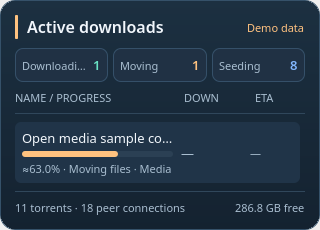
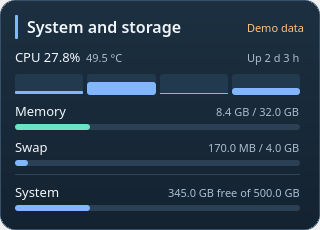

# Plasma Media Widgets

Keep qBittorrent downloads and disk activity in view on your KDE Plasma desktop. Add the widget twice to put the download queue and system usage side by side.

| Card | What you can see |
| --- | --- |
| **Active downloads** | Downloads sorted by ETA, rates, seed counts, recently finished items, and files currently moving to their destination. |
| **System and storage** | CPU load per core, temperature where supported, memory and swap, free space on selected mounts, and read/write rates for selected disks. |

A local Rust process serves both cards. The download card reads the qBittorrent Web UI API. The system card samples Linux counters. Each card can run independently.

 

## Try the demo

Requires a Linux desktop running **KDE Plasma 6** with **KPackageTool 6**, plus **Rust 1.88 or newer** to build the backend. The demo uses included fixture data.

```sh
git clone https://github.com/rowkavdev/plasma-media-widgets.git
cd plasma-media-widgets
kpackagetool6 --type Plasma/Applet --install widget
cargo run --locked --release -- --demo
```

Right-click the desktop, choose **Enter Edit Mode**, then **Add Widgets**. Search for **Plasma Media Widgets** and drag it onto the desktop. To show the other card, add a second instance and choose **System and storage** under **Configure Plasma Media Widgets → Widget → Card**.

## Use live data

Stop the demo with **Ctrl+C**. For CPU, memory and the root filesystem, launch the backend with no arguments.

```sh
cargo run --locked --release
```

For qBittorrent or custom disks, copy the sample and edit the URL, paths and block device names to match your machine.

```sh
cp examples/config.json config.json
cargo build --locked --release
```

If the Web UI requires authentication, set both environment variables before starting the binary. This Bash example reads the password without putting it in shell history.

```bash
export QB_USERNAME=your-webui-user
read -rsp 'qBittorrent Web UI password: ' QB_PASSWORD
printf '\n'
export QB_PASSWORD
./target/release/plasma-media-widgets --config config.json
```

Enable the Web UI in qBittorrent and use its actual address, including any existing reverse-proxy subpath. The download feed targets qBittorrent 5.x. Use an HTTPS URL when sending credentials to another machine. The widget connects to the backend on this desktop at `127.0.0.1:18771`. If you change `port`, set **Local backend port** in each widget instance to the same number.

| Configuration key | Meaning |
| --- | --- |
| `qbittorrent.url` | Base URL of the Web UI. Omit the `qbittorrent` block for system-only use. |
| `qbittorrent.move_paths` | Optional list of paths that let the backend inspect a move destination. Each entry pairs an absolute `client_root` from qBittorrent with a readable `local_root` on the Plasma machine. For a local client both roots can be identical. |
| `system.disks` | Mountpoints to monitor, such as `/` and `/mnt/media`. Use `findmnt` to check the mount paths. A missing mount displays as unavailable. |
| `system.devices` | Linux block devices to monitor, such as `sda` and `nvme0n1`. Use the names shown under `/sys/block`. |

### Move progress

qBittorrent reports when a torrent is moving, but the Web UI API does not give a separate byte count for the move. With a path mapping, the backend counts allocated bytes at the destination and the card marks that percentage as approximate. Preallocation, compression, partial file selection and same-filesystem moves can affect the estimate. With an unreadable or unmapped destination, the moving torrent stays visible and displays **Move progress unavailable**. The backend only reads torrent state and filesystem metadata.

## Upgrade or remove

From the repo, run the upgrade command after pulling a new version. Rebuild the backend and restart it to load its updates.

```sh
kpackagetool6 --type Plasma/Applet --upgrade widget
cargo build --locked --release
```

Remove the widget package with `kpackagetool6 --type Plasma/Applet --remove dev.rowkav.mediawidgets`. Stop the backend with **Ctrl+C**.

## Development

The Plasma package lives in `widget/` and its Rust backend in `src/`. Run `cargo test --locked` for the backend tests. With the demo running, `curl http://127.0.0.1:18771/downloads` and `curl http://127.0.0.1:18771/system` show the snapshots used by the cards.

The [KDE Plasma widget documentation](https://develop.kde.org/docs/plasma/widget/) covers the applet format. The download feed uses the [qBittorrent Web UI API](https://github.com/qbittorrent/qBittorrent/wiki/WebUI-API-%28qBittorrent-5.0%29).

Released under the [MIT License](LICENSE).
